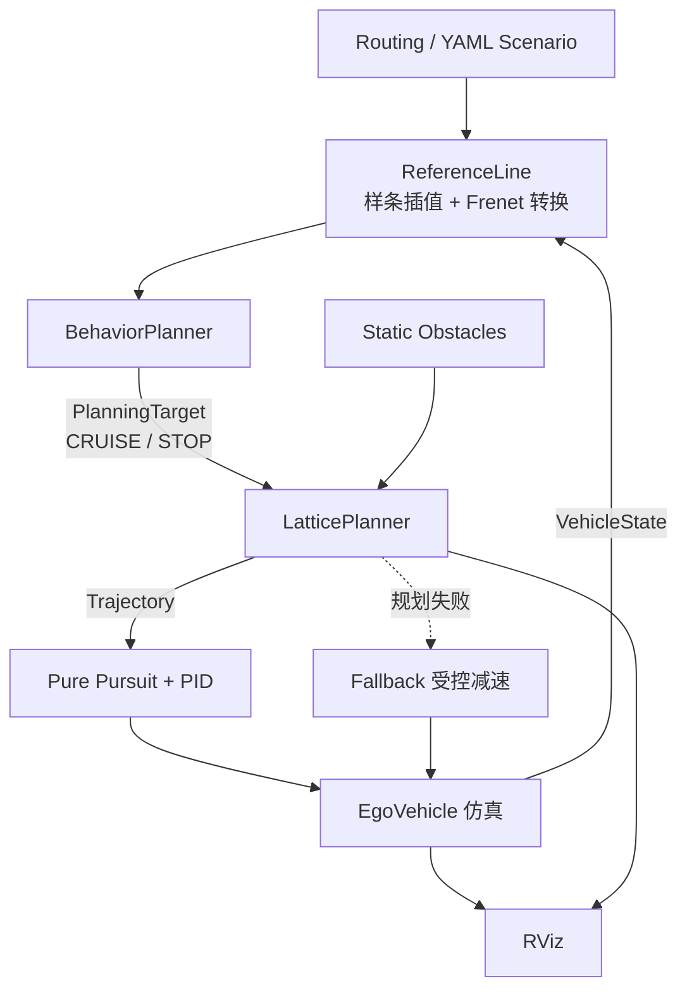

# ROS2 PNC Planner

[](https://github.com/gj-465930/ros2-pnc-planner/actions/workflows/ci.yml)


[](LICENSE)

基于 ROS2 和 C++17 的自动驾驶局部规划与控制闭环：在 Frenet 坐标系下做 Lattice 轨迹采样，配合 CRUISE/STOP 行为分层、静态障碍物绕行、Pure Pursuit + PID 轨迹跟踪，以及 YAML 场景回归和 RViz 可视化。

<!--
演示动图放在 docs/media/ 后取消注释：
<p align="center">
  
</p>
-->

## 功能概览

| 模块 | 内容 |
|---|---|
| 参考线 | 路径点 + 三次样条插值（追赶法求解），Cartesian ↔ Frenet 双向转换，分层投影搜索 |
| 行为层 | `BehaviorPlanner` 输出 `PlanningTarget`：CRUISE（目标速度）/ STOP（停车位置 `stop_s`），STOP 触发后锁存 |
| 局部规划 | Lattice Planner：横向五次多项式 × 纵向巡航/停车多项式采样，速度、加速度、jerk 约束过滤，静态障碍物碰撞过滤与终端安全检查，代价选择 |
| 安全降级 | 规划失败时清除陈旧轨迹并执行参数化受控减速，与正常 STOP 分开处理 |
| 控制与仿真 | Pure Pursuit 横向控制，带加速度前馈的 PID 纵向控制，简化自车运动学仿真 |
| 场景系统 | YAML 描述路线、自车初始状态和静态障碍物，`scenario_publisher` 通过 transient-local topic 驱动规划节点 |
| 可视化与诊断 | RViz 显示参考线、候选轨迹、选中轨迹、障碍物、停车目标；日志输出候选数量、拒绝原因、代价和规划耗时 |
| 测试 | 6 个 gtest target、51 个用例，覆盖数学基础、参考线、场景解析、行为决策和 Lattice 规划 |

## 系统架构



代码分为三层：

- `pnc_planner_core`：纯 C++ 算法库（数学、参考线、行为、Lattice、控制器），不依赖 ROS，可独立链接测试。
- `pnc_planner_runtime`：ROS2 节点、自车仿真、TF 广播和 RViz 发布。
- `pnc_planner_node`：节点入口。

详细设计见 [docs/architecture.md](docs/architecture.md)。

## 场景验证

| 场景 | 验证内容 | 结果 |
|---|---|---|
| `straight_cruise` | 直线巡航后在路线末端正常停车 | Pass：最终 s≈57.999 m，v=0 |
| `curve_cruise` | 缓弯巡航后正常停车 | Pass：最终 s≈39.026 m，v=0 |
| `end_of_route` | 靠近终点时触发 STOP | Pass：stop_s=18 m，最终 s≈17.999 m，v=0 |
| `static_obstacle_avoid` | 静态障碍物闭环绕行 | Pass：l=3.5 m 绕过后回到 l=0，正常停车 |
| `static_obstacle_blocked` | 道路完全阻塞时安全降级 | Pass：fallback 减速，停在 x≈4.4 m |

前四个场景全程没有触发 fallback。单周期规划耗时约 0.13–0.47 ms（规划周期 100 ms）。场景结果来自 RViz 和节点日志的人工检查，记录见 [docs/scenario_validation.md](docs/scenario_validation.md)。

## 设计要点

开发中遇到并解决的几个问题：

- **连续重规划中的左右摆动**：相邻周期选中的横向目标来回切换。加入横向目标变化代价，并为目标偏移和硬约束边界保留余量后，绕行方向保持稳定。
- **短时域候选规避风险**：较短的纵向候选在障碍物之前就结束，代价反而更低，等障碍物进入视野时已来不及横移。统一纵向候选的规划时域，并让横向多项式在定义域之外保持终点状态。
- **停车候选退化**：规划时域较短时，STOP 时长采样只剩一个候选。改为根据剩余距离和舒适减速度估算时长下界，并至少向后搜索 1 s。
- **停车点附近的投影精度**：Frenet 投影误差导致停车位置抖动。增加 0.001 m 的分层搜索，并补充停车点附近的精度回归测试。
- **正常停车与安全降级分离**：正常 STOP 生成可跟踪的停车轨迹；规划失败时清空旧轨迹并减速。两条路径在接口、日志和测试中都可区分。

## 快速开始

环境：ROS2 Humble，C++17，colcon。

```bash
# 编译
colcon build --packages-select pnc_planner
source install/setup.bash   # zsh 用 setup.zsh

# 终端 1：启动 planner、robot_state_publisher 和 RViz
ros2 launch pnc_planner pnc_planner.launch.py

# 终端 2：发布一个场景
ros2 run pnc_planner scenario_publisher --ros-args \
  -p scenario_file:=src/pnc_planner/scenarios/static_obstacle_avoid.yaml
```

一个 planner 进程只运行一个场景，切换场景前需要重启 planner。场景格式见 [docs/scenario_schema.md](docs/scenario_schema.md)，运行时生命周期见 [docs/scenario_execution_design.md](docs/scenario_execution_design.md)。

运行参数位于 `src/pnc_planner/config/planner_config.yaml`。设置 `use_mock_routing: true` 可以不依赖场景文件，直接使用内置 mock 路线。

## 运行测试

```bash
colcon test --packages-select pnc_planner \
  --event-handlers console_direct+ --ctest-args -R '^test_'
colcon test-result --verbose
```

`-R '^test_'` 只运行功能 gtest。不带过滤时还会运行 ament lint，目前格式规则尚未完全统一。

## 目录结构

```text
src/pnc_planner/
  include/pnc_planner/   头文件（math / planning / controller / runtime / ...）
  src/
    math/                样条、Frenet 转换、五次多项式
    planning/            参考线、Lattice、行为规划
    controller/          Pure Pursuit、PID
    runtime/             ROS2 主节点
    simulation/          自车仿真与 TF
    visualization/       RViz 发布
    scenario/            场景加载与发布
  msg/                   场景初始状态、障碍物消息
  scenarios/             YAML 场景
  config/ launch/ rviz/ urdf/
  test/                  gtest 单元测试
docs/                    架构、场景格式、验证记录和开发笔记
```

## 范围与边界

- 这是一个用于学习和验证的局部规划与控制原型，不是生产级自动驾驶系统。
- 障碍物由场景文件给出，仅支持静态障碍物，碰撞检测使用简化的距离模型。
- 行为层只包含路线终点的 CRUISE/STOP；道路完全阻塞时走安全降级，而不是正常停车决策。
- 场景通过状态由人工检查，`expected` 字段尚未自动判定。

## 后续方向

自动场景指标与批量回归、矩形（OBB）碰撞检测、动态障碍物预测与 ST 图、基于 QP 的 EM Planner，以及 LQR 等控制器的跟踪误差对比。

## 开发笔记

- [Cartesian-Frenet 坐标转换实现](docs/blog/Cartesian-Frenet坐标转换实现.md)
- [追赶法 C++ 实现](docs/blog/追赶法Cpp实现.md)
- [PncPlannerNode 模块开发记录](docs/blog/PncPlannerNode模块开发记录.md)
- [EgoVehicle 模块开发记录](docs/blog/ROS2-EgoVehicle模块开发记录.md)
- [Visualizer 模块开发记录](docs/blog/ROS2-Visualizer模块开发记录.md)

## License

[Apache License 2.0](LICENSE)
